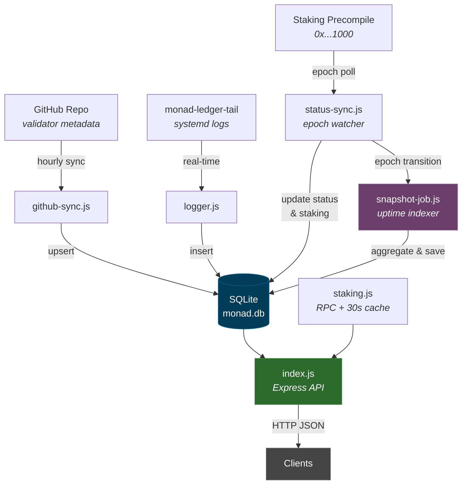
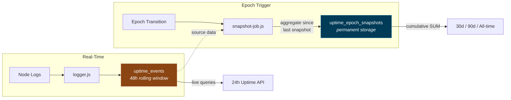

# Monad Validator API

[](https://nodejs.org/)
[](https://expressjs.com/)
[](https://www.sqlite.org/)
[](https://monad.xyz/)
[](LICENSE)

Validator metadata, uptime tracking, and on-chain staking data API for Monad.

## Features

- **Validator Metadata** — Auto-synced from GitHub (hourly)
- **Uptime Tracking** — Real-time log analysis (finalized/timeout rounds)
- **Historical Uptime** — Epoch-based snapshots with 30d / 90d / all-time cumulative views
- **On-Chain Staking** — Live queries to the staking precompile (`0x...1000`)
- **Delegation Data** — Per-validator delegator lists, per-address delegation summaries
- **Epoch Awareness** — Auto-syncs on epoch transitions and boundary blocks
- **Lightweight** — SQLite + in-memory cache, no external DB required

## Architecture



## Data Flow



## Data Sources

| Source | What | Freshness |
|--------|------|-----------|
| **SQLite (cached)** | Validator list, stake, commission, uptime stats, pool totals | Synced hourly + on epoch change |
| **Live RPC** | `/staking/validator/:id`, `/staking/delegator/:addr`, epoch info | Real-time (30s in-memory cache) |
| **GitHub** | Validator names, logos, websites, social links | Hourly |

## Setup

```bash
git clone <repo> monad-api && cd monad-api
npm install
cp .env.example .env   # edit with your values
npm run sync            # initial metadata sync
npm start               # start API server
```

## Processes

| Process | Command | Description |
|---------|---------|-------------|
| API Server | `npm start` | Express HTTP server + status sync + epoch watcher + snapshot indexer |
| Uptime Logger | `npm run logger` | journalctl → SQLite (real-time) |
| Metadata Sync | Built-in | Runs inside API server (hourly) |
| Status Sync | Built-in | Runs inside API server (hourly + epoch transitions) |
| Snapshot Indexer | Built-in | Triggered by epoch watcher on each epoch transition |

## Database Schema

### `validators`
Validator metadata, on-chain staking data, and status.

### `uptime_events`
Rolling window (48h default) of raw finalized/timeout events per round.
Used for live 24h uptime API queries. Cleaned up after snapshotting.

### `uptime_epoch_snapshots`
Permanent historical record. One row per validator per epoch.

| Column | Type | Description |
|--------|------|-------------|
| `validator_id` | INTEGER | Validator ID |
| `secp_address` | TEXT | Validator secp address |
| `epoch` | INTEGER | Epoch number |
| `finalized_count` | INTEGER | Finalized rounds in this epoch |
| `timeout_count` | INTEGER | Missed/timeout rounds in this epoch |
| `total_events` | INTEGER | Total rounds |
| `uptime_percent` | REAL | Uptime % for this epoch |
| `snapshot_ts` | INTEGER | Unix timestamp when snapshot was taken |

Cumulative queries aggregate across epochs:
- **All-time**: `SUM(*)` across all epoch snapshots
- **30 days**: `SUM(*)` where `snapshot_ts >= now - 30d`
- **90 days**: `SUM(*)` where `snapshot_ts >= now - 90d`

## API Endpoints

**Base URL:** `http://localhost:3000/monad-api`

### Validators

```
GET /monad-api/validators                        # All validators (metadata + stake)
GET /monad-api/validators/:idOrAddress           # Single validator by ID or secp address
GET /monad-api/validators/uptime                 # All validators uptime (?window=24&sort=uptime)
GET /monad-api/validators/uptime/:idOrAddress    # Single validator uptime
GET /monad-api/validators/uptime/:id/history     # Round-by-round history (?limit=49)
GET /monad-api/validators/stats                  # Validator count
```

### Staking (On-Chain)

```
GET /monad-api/staking/epoch                     # Current epoch + in_delay_period
GET /monad-api/staking/pool                      # Bonded tokens, total staked, on-chain validator counts
GET /monad-api/staking/validator/:id             # Validator stake, commission, rewards (live)
GET /monad-api/staking/validator/:id/delegators  # All delegators of a validator (live)
GET /monad-api/staking/delegator/:address        # All delegations for an address (live)
```

### System

```
GET /health                                      # Health check
GET /monad-api                                   # API info & endpoint list
```

### Example Responses

<details>
<summary><b>GET /monad-api/staking/pool</b></summary>

```json
{
  "success": true,
  "bonded_tokens": 12300712423.81,
  "total_staked": 12303076653.87,
  "total_validators": 229,
  "active_validators": 200,
  "epoch": 1163,
  "in_delay_period": false
}
```
</details>

<details>
<summary><b>GET /monad-api/staking/validator/41</b></summary>

```json
{
  "success": true,
  "validator": {
    "id": 41,
    "name": "Allnodes",
    "secp_address": "0x8a5a...",
    "status": "active",
    "stake": 11000000,
    "commission": 10,
    "unclaimed_rewards": 54150.55,
    "auth_address": "0x8a5a..."
  }
}
```
</details>

<details>
<summary><b>GET /monad-api/staking/delegator/0xbf4b...</b></summary>

```json
{
  "success": true,
  "address": "0xBF4b...",
  "total_staked": 100000,
  "total_rewards": 18868.75,
  "delegation_count": 1,
  "delegations": [
    {
      "validator_id": 40,
      "validator_name": "Huginn",
      "validator_status": "active",
      "stake": 100000,
      "unclaimed_rewards": 18868.75
    }
  ]
}
```
</details>

### Query Parameters

| Endpoint | Param | Default | Range | Description |
|----------|-------|---------|-------|-------------|
| `/uptime` | `window` | 24 | 1-168 | Hours window |
| `/uptime` | `sort` | uptime | uptime, id | Sort order |
| `/uptime/:id/history` | `limit` | 49 | 1-100 | Number of rounds |

## Environment Variables

| Variable | Default | Description |
|----------|---------|-------------|
| `PORT` | 3000 | API port |
| `HOST` | 0.0.0.0 | Bind address |
| `MONAD_RPC_URL` | http://127.0.0.1:8080 | Monad RPC endpoint |
| `JOURNAL_UNIT` | monad-ledger-tail | Systemd unit for log tailing |
| `GITHUB_RAW_BASE` | ...validator-info/main/mainnet | Metadata source |
| `METADATA_SYNC_INTERVAL_MS` | 3600000 | Metadata sync interval (1h) |
| `STATUS_SYNC_INTERVAL_MS` | 3600000 | Staking data sync interval (1h) |
| `EPOCH_POLL_MS` | 120000 | Epoch watcher poll interval (2min) |
| `UPTIME_RETENTION_HOURS` | 48 | Old event cleanup threshold |
| `LOG_LEVEL` | info | error / warn / info / debug |

## Systemd (Production)

Two separate services share the same SQLite database (WAL mode):

```
monad-api.service            → node index.js   (API + sync + epoch watcher + snapshots)
monad-uptime-logger.service  → node logger.js  (journalctl → uptime_events)
```

See `services.txt` for systemd unit files. Quick setup:

```bash
sudo cp systemd/monad-api.service /etc/systemd/system/
sudo cp systemd/monad-uptime-logger.service /etc/systemd/system/
sudo systemctl daemon-reload
sudo systemctl enable --now monad-api monad-uptime-logger
```

Monitor:
```bash
journalctl -u monad-api -f              # API + epoch watcher + snapshots
journalctl -u monad-uptime-logger -f    # Real-time log parser
```

## Notes

- All monetary values are returned as **raw numbers** (not formatted strings) for safe client-side parsing
- **30s in-memory cache** on live RPC calls prevents redundant queries under burst traffic
- **Epoch watcher** polls every 2 minutes and triggers a full sync on epoch transitions or boundary blocks
- **Uptime snapshots** are taken at each epoch transition (~5.5h), ensuring no data loss from the rolling event window
- **Cleanup safety**: events are only deleted after being snapshotted — if no snapshot exists, nothing is deleted
- `total_validators` from DB (all known), `active_validators` from on-chain consensus set
- SQLite WAL mode enables concurrent reads/writes across both services
- GitHub sync failures preserve existing data (no data loss)

## License

This project is licensed under the [MIT License](LICENSE).
