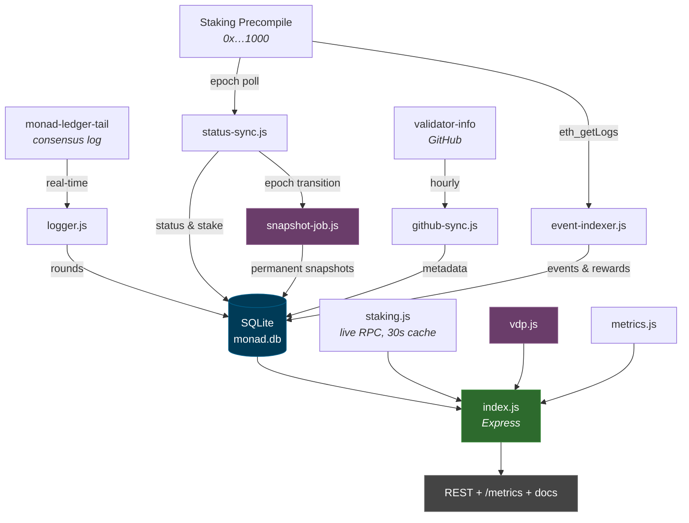
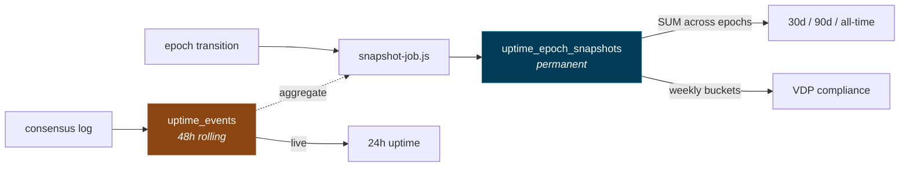

# Monad Validator & Staking API

[](https://nodejs.org/)
[](https://expressjs.com/)
[](https://www.sqlite.org/)
[](openapi.json)
[](https://monad.xyz/)
[](LICENSE)

Validator uptime, VDP compliance and on-chain staking data for Monad, served
as read-only REST.

Uptime is read from the consensus log of our own nodes, because that is the
only place block authorship appears. None of Monad's three real-time data
sources carry the proposer, and the staking precompile reports only who is
proposing right now, with no history. Running this next to a node that
follows consensus is therefore not an implementation detail — it is what
makes the dataset possible.

Live: [validator-api.huginn.tech](https://validator-api.huginn.tech) ·
[testnet](https://validator-api-testnet.huginn.tech)

## What it holds

Raw rounds land in a 48-hour rolling window and are rolled up into permanent
per-epoch snapshots before they age out, so 30-day, 90-day and all-time figures
survive long after the events are gone. Staking precompile events are indexed
as they are emitted, since a full node keeps only a few days of logs; older
history is filled in from an archive node by the backfill.

From that history the service computes VDP compliance — weekly uptime against
the 98% line and strikes inside the rolling three-month window — which is
otherwise not something an operator can check for themselves. Three strikes
report as `breach`, meaning the condition is met; whether the Foundation
removes delegation is its call and not something the API can see.

## Architecture



## How uptime survives the window



Events are only deleted once they have been snapshotted. If no snapshot exists,
cleanup removes nothing, so a stalled indexer costs disk rather than history.

## Endpoints

The full reference lives at `/` on a running instance, generated from
[`openapi.json`](openapi.json), where each endpoint can also be called live.
`GET /monad-api` returns the same list as JSON and `/llms.txt` renders it as
plain text for agents. All three come from the one document.

| | |
|---|---|
| `GET /monad-api/validators` | Metadata, stake, status. `?limit` `?offset` |
| `GET /monad-api/validators/stats` | Counts by status |
| `GET /monad-api/validators/{id}` | One validator, by ID or secp address |
| `GET /monad-api/validators/uptime` | All validators. `?window` or `?period`, `?sort`, `?limit` |
| `GET /monad-api/validators/uptime/{id}` | One validator |
| `GET /monad-api/validators/uptime/{id}/history` | Round by round |
| `GET /monad-api/validators/network/uptime` | Per epoch, network-wide |
| `GET /monad-api/validators/vdp` | Compliance for every validator, worst first |
| `GET /monad-api/validators/{id}/vdp` | Week by week, with the strike breakdown |
| `GET /monad-api/validators/{id}/health` | `healthy` / `degraded` / `stale` / `no_data` |
| `GET /monad-api/staking/epoch` | Current epoch and delay period |
| `GET /monad-api/staking/pool` | Bonded, staked, APR |
| `GET /monad-api/staking/validator-set` | Who enters and leaves next epoch |
| `GET /monad-api/staking/proposer` | Current block proposer |
| `GET /monad-api/staking/validator/{id}` | Live stake, commission, pending changes |
| `GET /monad-api/staking/validator/{id}/delegators` | Paginated, up to 100 per page. `?limit` `?cursor` |
| `GET /monad-api/staking/validator/{id}/rewards` | Block and external rewards per epoch |
| `GET /monad-api/staking/blocks` | Blocks proposed per validator since rewards began. `?since_epoch` |
| `GET /monad-api/staking/validator/{id}/events` | Indexed events for one validator |
| `GET /monad-api/staking/events` | Network-wide. `?type` `?address` `?limit` |
| `GET /monad-api/staking/delegator/{address}` | Every delegation an address holds |
| `GET /monad-api/staking/flow` | Net stake movement per validator. `?period=24h|7d|30d|all` |
| `GET /monad-api/staking/validator/{id}/flow` | Same, for one validator |
| `GET /monad-api/status` | Data freshness: newest round, last snapshot, indexer cursor |
| `GET /health` | Liveness |
| `GET /metrics` | Prometheus exposition |
| `GET /llms.txt` | Agent-readable rendering of the spec |

Uptime endpoints answer two different questions. Without `period` they read the
rolling event window (`?window=1..168` hours, default 24). With
`?period=30d|90d|all` they read the permanent snapshots, which reach back
further. Results come sorted by uptime, so adding `?limit` gives a leaderboard.

## Decisions worth knowing

**Two APR figures, not one.** `/staking/pool` publishes `estimated_apr` from
the block time the documentation implies and `calculated_apr` from the block
time measured across recent epochs, alongside every input. A hardcoded block
time is the classic way to be quietly wrong about yield: the constant this
service previously used was correct until a hardfork shortened epochs from
5.5h to 4h12m, after which it would have been off by a third. The measured
figure tracked the change on its own.

**Weekly uptime is summed, not averaged.** A week's rate is
`Σ finalized / Σ total` across its epochs. Averaging the per-epoch percentages
instead would let a quiet epoch outweigh a busy one.

**Absence is not a clean record.** A validator that leaves the active set stops
producing rounds, so its weeks go missing rather than bad. Compliance therefore
counts the weeks the window should hold against the weeks actually observed;
any shortfall reports as `insufficient_data` rather than as no strikes. Silence
must not score better than staying up and occasionally missing.

**Only completed weeks can be strikes.** A validator two hours into a bad
Monday has not breached anything yet.

**VDP is scoped to mainnet.** The weekly maths runs anywhere, but a strike on
testnet carries no consequence, so those series are withheld from `/metrics`
there and the endpoints report `applies: false`. The distinction comes from
`NETWORK`, since both networks run this same code.

**Delegator lists are paginated against the precompile's own cursor.** Walking
the whole set turns one HTTP request into an unbounded number of RPC calls,
which the staking documentation explicitly warns against.

**The event indexer finds out what the node still has.** A node that is not
an archive node serves logs for a window of recent blocks, and the size of
that window depends on its disk, not on the chain. On our mainnet node it is
about 950,000 blocks, roughly 79 hours. If the service falls behind that
window, the first `eth_getLogs` on the oldest missing chunk fails, and an
indexer that simply retries sits on the same block forever while reporting a
valid cursor.

When a chunk fails, the indexer probes the failing block and a recent one. If
only the old one fails, it binary searches for the oldest block the node still
serves, about twenty calls, records the skipped range under
`event_indexer.gaps` in `/monad-api/status`, and resumes
`EVENT_INDEXER_EDGE_MARGIN` blocks above that edge. If the recent block fails
too, the node is unwell rather than pruned, and the cursor stays put. None of
this reads the error text, which differs between clients, and there is no
retention size to configure, so it behaves the same on any node. On an archive
node it never triggers.

`/monad-api/status` also carries `last_success_utc`, `stalled` and
`last_error`, so a stuck indexer shows as stuck rather than as a number that
happens not to change.

**Not every reward is a block.** `ValidatorRewarded` fires once per block,
sent by the system address `0x6f49…dc9e`, to pay the proposer. Anyone can also
call `externalReward`, which emits the same event with the caller as sender;
on mainnet that happens about a hundred times an epoch. Only the first kind
counts as a proposed block. The two used to be summed together, which is why
block counts ran slightly high.

**The block reward is read from the chain, not assumed.** A block reward
event carries `reward x (1 - commission)`, so the largest one in an epoch,
paid to a validator at 0% commission, is the full reward. On mainnet that
comes out as 0 when rewards began, 25 MON until mid-2026, and 18 MON since.
Gross and commission figures use each epoch's own value.

**Epochs are about 50,000 blocks, not exactly.** The new epoch starts after a
delay counted in rounds, and a round that times out produces no block, so the
boundary drifts by a block here and there. The archive backfill therefore
closes an epoch at the first block reward tagged with the next one, and only
stores it if every block in its span paid exactly one block reward.

## Setup

```bash
git clone <repo> monad-api && cd monad-api
npm install
cp .env.example .env      # edit
npm run sync              # first metadata pull
npm start
```

Two processes share one SQLite database in WAL mode:

| | |
|---|---|
| `npm start` | API, metadata sync, epoch watcher, snapshot indexer, event indexer |
| `npm run logger` | `journalctl` → `uptime_events` |

`npm run index-events` runs a single indexer pass; `npm run status-sync` and
`npm run sync` do the same for staking data and metadata.

### Systemd

```
monad-api.service            → node index.js
monad-uptime-logger.service  → node logger.js
```

Units are in `services.txt`.

```bash
sudo cp systemd/*.service /etc/systemd/system/
sudo systemctl daemon-reload
sudo systemctl enable --now monad-api monad-uptime-logger
journalctl -u monad-api -f
```

### Behind a reverse proxy

`TRUST_PROXY` defaults to `loopback`, which is correct for nginx on the same
host: without it every request appears to come from `127.0.0.1` and the per-IP
rate limiter becomes one shared bucket. It is deliberately not `true`, which
would accept any `X-Forwarded-For` a client sends and let anyone forge an
address past the limit.

One `location /` is enough — it covers the API, the docs, `/health` and
`/metrics`.

## Backfilling history

The live indexer reads forward from where it started, and a full node keeps
only a few days of logs. `backfill-events.js` fills everything else from an
archive RPC: every epoch since block rewards began, and any range the live
indexer had to skip.

```bash
# mainnet: rpc1 serves 5,000 blocks a request; about 50 minutes for all of it
npm run backfill

# testnet: its archives cap a request at 100 blocks, so spread the load
npm run backfill -- --rpc https://rpc-testnet.monadinfra.com,https://testnet-rpc.monad.xyz \
                   --chunk 100 --concurrency 10          # about 90 minutes

npm run backfill -- --verify            # completeness report only
```

It rebuilds one completed epoch at a time and replaces that epoch's rows in a
single transaction, so it can be stopped and rerun freely, and a rerun only
touches epochs that are missing or incomplete. It checks that every archive
is on the same chain as `MONAD_RPC_URL` before writing anything, never
touches the epoch the live indexer is in, and clears a recorded gap once the
epochs covering it are complete. Rate-limited requests are retried on the next
archive in the list. The epoch that was live when the backfill ran is picked
up by the next run, once it has closed.

## Environment

| Variable | Default | |
|---|---|---|
| `PORT` | `3000` | |
| `HOST` | `127.0.0.1` | `0.0.0.0` only when clients must reach the port without a proxy |
| `NETWORK` | `testnet` | Set it explicitly — see below |
| `MONAD_RPC_URL` | `http://127.0.0.1:8080` | |
| `JOURNAL_UNIT` | `monad-ledger-tail` | Unit the logger tails |
| `TRUST_PROXY` | `loopback` | Hops trusted for `X-Forwarded-For` |
| `METADATA_SYNC_INTERVAL_MS` | `3600000` | |
| `STATUS_SYNC_INTERVAL_MS` | `3600000` | |
| `EPOCH_POLL_MS` | `120000` | Epoch watcher |
| `UPTIME_RETENTION_HOURS` | `48` | Rolling window for raw rounds |
| `EVENT_INDEXER_POLL_MS` | `30000` | |
| `EVENT_INDEXER_CHUNK` | `1000` | Blocks per `eth_getLogs` |
| `EVENT_INDEXER_CONFIRMATIONS` | `10` | Blocks to stay behind the head |
| `EVENT_INDEXER_START_BLOCK` | — | Backfill from here on first run |
| `ARCHIVE_RPC_URL` | `https://rpc1.monad.xyz` | Archive(s) for the backfill, comma separated |
| `EVENT_INDEXER_EDGE_MARGIN` | `10000` | Blocks above the node's retention edge to resume from after a skip |
| `LOG_LEVEL` | `info` | |

`NETWORK` decides three things: which directory metadata is pulled from,
whether VDP applies, and the label on `monad_build_info`. Left unset it falls
back to `testnet` for metadata but reports `unknown` in metrics and disables
VDP, so a mainnet deployment that forgets it loses the compliance series
without any error. Set it.

## Storage

`validators` holds metadata and synced on-chain staking data.
`uptime_events` is the rolling window of raw rounds.
`uptime_epoch_snapshots` is the permanent record, one row per validator per
epoch, and the basis of every cumulative and compliance figure.

`ValidatorRewarded` fires once per block, so it is rolled up per validator per
epoch in `validator_rewards_epoch` rather than stored raw — roughly 68 MB a
year instead of 16 GB. The other eight events go into `staking_events`, keyed
on `(block_number, log_index)`. Its row shape is deliberately loose, so a new
event type means a new enum value rather than a new table.

Writes and the indexer cursor advance in the same transaction. Rewards
accumulate by read-modify-write, so a replayed range would otherwise double
count; a crash rolls back both and the range is retried from a clean state.

## Metrics

`/metrics` exposes the dataset in Prometheus text format — per-validator
uptime, stake, commission and VDP strikes, plus network totals, indexer
progress and the measured block time. Every value is read from SQLite; nothing
in `metrics.js` touches the RPC, so a scrape cannot stall behind the node.

```yaml
scrape_configs:
  - job_name: monad-validator-api
    scrape_interval: 30s
    scheme: https
    static_configs:
      - targets: ['validator-api.huginn.tech:443']
        labels: { network: mainnet }
      - targets: ['validator-api-testnet.huginn.tech:443']
        labels: { network: testnet }
```

Validator IDs start at 1 on both networks and mean different validators, so
`monad_build_info` carries the network as a label.

## Notes

Monetary values are returned as numbers, not formatted strings. Live RPC calls
share a 30-second in-memory cache, capped in size. A failed GitHub sync leaves
existing metadata untouched.

Per-IP limits are ceilings against abuse, set well above what real clients
send:

| Routes | Limit per IP |
|---|---|
| Staking | 60 per minute |
| Staking delegators and delegations (`/validator/{id}/delegators`, `/delegator/{address}`) | a further 60 per minute between them; 8 at once across all callers, else 503 `BUSY`; 504 after 30 s |
| Validators | 300 per second |
| All-validator uptime, `/network/uptime`, `/vdp`, `/metrics`, `/monad-api/status` | 50 per second |

Limited routes return `X-RateLimit-*` headers, and a rejected request gets 429
with `Retry-After`. The all-validator aggregates and `/metrics` are reused for
20 to 30 seconds and `/monad-api/status` for 10, so a burst of callers shares
one pass over the database.

Error responses carry a stable `code` next to `error`: `RATE_LIMITED`, `BUSY`,
`TIMEOUT`, `UPSTREAM_ERROR` or `INTERNAL`. What actually failed is written
to the server log, not returned.

## License

[MIT](LICENSE).
